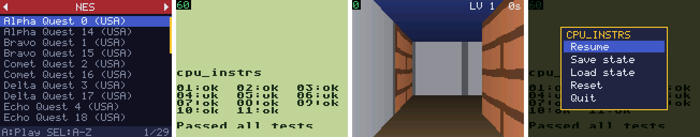

# Retro Pocket

A small Retro-Go style firmware for an **ESP32-S3** handheld. Copy downloaded
games (`.zip`, `.nes`, `.gb`, `.gbc`) anywhere on the SD card. At boot it scans
the card, sorts every game it finds under NES or Game Boy, and you pick one and
play it on a 1.77" ST7735 screen with 4 buttons and an analog joystick.



*Screenshots from the PC simulator, at 2x.*

| System      | Core | Notes |
|-------------|------|-------|
| NES         | [agnes](https://github.com/kgabis/agnes) (MIT) | Mappers 0, 1, 2, 4 (NROM, MMC1, UxROM, MMC3). Save states, battery saves. |
| Game Boy    | [Peanut-GB](https://github.com/deltabeard/Peanut-GB) (MIT) | All DMG games and dual-mode `.gbc`, 5 color palettes, save states, battery saves. Passes Blargg's `cpu_instrs`. |
| Built-in    | Maze Runner 3D | An original first-person 3D maze game (raycaster) with analog movement, so you get some 3D on the device. |

There is no sound yet, because the parts list has no speaker. See "Ideas" below.

## About Mario 64

Mario 64 **can't run on an ESP32-S3**, or any microcontroller like it. The PC
port needs roughly a 1 GHz CPU and a GPU with OpenGL. The S3 is a 240 MHz chip
with no GPU and about 0.5 MB of fast RAM. To play it on a handheld you need a
**Raspberry Pi Zero 2 W** (or similar), running Linux and the sm64 port built
from **your own** cartridge dump. That's a different project from this
firmware. The built-in *Maze Runner 3D* is what this board can do in 3D.

## Parts

- ESP32-S3 dev board **with PSRAM**: N8R8 or N16R8 (e.g. ESP32-S3-DevKitC-1 N16R8)
- 1.77" 128x160 SPI TFT, ST7735 / ST7735S
- micro SD card module (SPI), card formatted **FAT32**
- 4 push buttons: A, B, START, SELECT
- analog joystick module (KY-023 style), with push button

## Wiring

All pins are set in [`main/board.h`](main/board.h). Change them there if you wire differently.

| Part | Pin on part | ESP32-S3 GPIO |
|------|-------------|---------------|
| TFT  | VCC         | 3V3 |
|      | GND         | GND |
|      | SCL / CLK   | 12 |
|      | SDA / DIN   | 11 |
|      | CS          | 10 |
|      | DC / A0 / RS| 9 |
|      | RES / RST   | 8 |
|      | BL / LED    | 7 (PWM brightness) |
| SD   | VCC         | 3V3 (or 5V if your module has a regulator) |
|      | GND         | GND |
|      | MOSI        | 15 |
|      | SCK         | 16 |
|      | MISO        | 17 |
|      | CS          | 18 |
| Buttons (other leg to GND) | A | 4 |
|      | B           | 5 |
|      | START       | 6 |
|      | SELECT      | 21 |
| Joystick | +5V / VCC | **3V3** (not 5V, or the ESP32's analog inputs get overdriven) |
|      | GND         | GND |
|      | VRx         | 1 |
|      | VRy         | 2 |
|      | SW          | 47 |

The buttons use the chip's internal pull-ups, so you don't need resistors.

## Controls

| Where | Control | Action |
|-------|---------|--------|
| Menu  | Stick left / right | Switch tab: NES, Game Boy, Built-in, Settings |
|       | Stick up / down    | Pick a game |
|       | A / START          | Play |
|       | SELECT             | Jump to the next letter (A, B, C...) |
| Settings | A / B           | Change value up / down |
| In game | Stick           | D-pad |
|       | A, B, START, SELECT | Same as the console |
|       | **Click stick**    | Pause menu: Resume, Save state, Load state, Reset, Quit |
| Maze Runner 3D | Stick     | Walk / turn (analog) |
|       | A (hold)           | Sprint |
|       | B (hold)           | Strafe instead of turning |
|       | SELECT (hold)      | Show map |

## Adding games

1. Download a game. A `.zip` is fine, **no need to unzip it**.
2. Copy it to the SD card, **in any folder** (the root, `/roms`, `/Downloads/whatever`...).
3. Put the card in and power on. The boot screen says "Looking for games..." and
   then every game shows up under the right tab, sorted A to Z.

Details:

- A zip counts as a game if it has a `.nes`, `.gb`, `.gbc` or `.dmg` file inside,
  even in a subfolder of the zip and next to readme files. The game shows up
  under the **zip's** name.
- `.7z` and `.rar` aren't supported. Re-zip them as `.zip` on your computer.
- The first boot with lots of new zips takes a few seconds while each one is
  opened. What's inside each zip is remembered in `/saves/zipcache.txt`, so
  after that only new or changed zips are checked.
- Added games while it's on? *Settings → Rescan SD card*.
- Folders up to 6 levels deep are searched. Hidden folders, `System Volume Information` and `/saves` are skipped.
- Saves go in `/saves/nes/` and `/saves/gb/`, named after the game.

Only use ROMs you made or have the right to use.

## Flashing the prebuilt firmware (easiest)

[`firmware/retro-pocket-esp32s3.bin`](firmware/retro-pocket-esp32s3.bin) is built for the
default pins above and octal PSRAM (N8R8 / N16R8). Flash it at offset **0x0**:

- in a browser: open <https://espressif.github.io/esptool-js/>, connect, set address `0x0`, pick the file, Program
- or from a terminal: `esptool.py --chip esp32s3 write_flash 0x0 firmware/retro-pocket-esp32s3.bin`

If you changed pins or have quad PSRAM, build it yourself (below).

## Building and flashing

You need [ESP-IDF v5.3](https://docs.espressif.com/projects/esp-idf/en/v5.3/esp32s3/get-started/).

```sh
cd retro-pocket
idf.py set-target esp32s3
idf.py build
idf.py -p /dev/ttyACM0 flash monitor     # COM3 etc. on Windows
```

If your board has **quad** PSRAM (N8R2, N4R2) instead of octal, change
`CONFIG_SPIRAM_MODE_OCT` to `CONFIG_SPIRAM_MODE_QUAD` in `sdkconfig.defaults`,
delete `sdkconfig`, and rebuild.

### Screen looks wrong?

Edit `main/board.h`:

- red and blue swapped: flip `LCD_BGR`
- colors inverted: flip `LCD_INVERT`
- upside down: flip `LCD_ROTATE_180`
- 1-2 px garbage line on an edge: set `LCD_X_OFFSET` / `LCD_Y_OFFSET` to 1 or 2
- noise or glitches: lower `LCD_SPI_HZ` to 26 MHz
- joystick directions wrong: `JOY_INVERT_X`, `JOY_INVERT_Y`, `JOY_SWAP_XY`

Don't touch the joystick while the device boots: that's when it learns the center position.

## PC simulator

`sim/` builds the real launcher, emulators and game for Linux/macOS. Button
presses come from a script and the screen is saved as images. It's handy for
testing changes without flashing:

```sh
cd sim && ./build.sh
mkdir -p simsd shots && cp some-game.zip simsd/     # simsd/ acts as the SD card
SIM_SCRIPT=demo.txt ./retro-pocket-sim             # writes the shots/*.ppm listed in the script
```

Each script line is `<frames to wait> <KEYS | shot:NAME | quit>`. Keys are joined
with `+`, e.g. `UP+A`, and `-` releases everything.

## Code map

```
main/board.h       pins and panel options
main/display.c     ST7735 driver, double-buffered DMA frames
main/input.c       buttons and joystick to D-pad, with auto-repeat
main/launcher.c    boot menu, game lists, settings
main/romscan.c     finds games anywhere on the SD card, zip cache, rom_load()
main/unzip.c       small .zip reader and DEFLATE decoder
main/system.c      pause menu, message boxes, frame pacing, file helpers
main/storage.c     SD card mount, settings in flash (NVS)
main/emu_gb.c      Game Boy front-end
main/emu_nes.c     NES front-end
main/game_maze.c   Maze Runner 3D
main/cores/        third-party emulator cores (MIT)
tools/gen_font.py  generates the 5x7 UI font
```

To add a system: write a `void my_run(const char *path)` that loads with `rom_load()`, add a `SYS_` value and its extensions in `romscan.c`, and add a row to `tabs[]` in `launcher.c`.

## Ideas / next steps

- **Sound:** add a MAX98357A I2S amp and a small speaker. Peanut-GB has an audio hook, and agnes would need an APU.
- **More systems:** Sega Master System / Game Gear (smsplus) or Game Boy Color (e.g. a GBC-capable fork of Peanut-GB).
- **Battery:** a LiPo with a TP4056 charger, and battery voltage read on an ADC pin.
