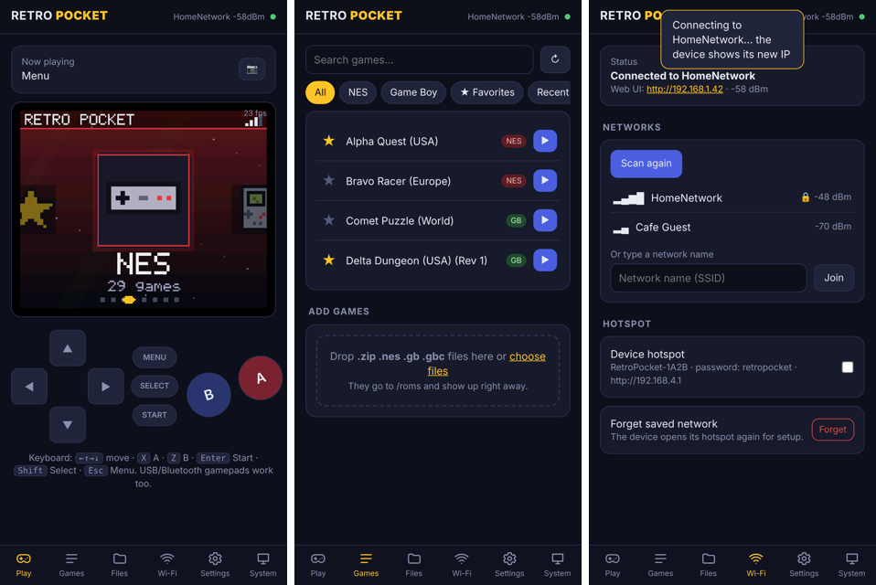

# Retro Pocket

A small Retro-Go style firmware for an **ESP32-S3** handheld. Copy downloaded
games (`.zip`, `.nes`, `.gb`, `.gbc`) anywhere on the SD card. At boot it scans
the card, sorts every game it finds under NES or Game Boy, and you pick one and
play it on a 1.77" ST7735 screen with 4 buttons and an analog joystick.

It also has **Wi-Fi**: a web UI on your phone (remote control with live screen,
game uploads, file manager, settings), and **firmware updates over Wi-Fi**, so
you only flash it by USB once.




*Device screenshots from the PC simulator at 2x; web UI from the mock device.*

| System      | Core | Notes |
|-------------|------|-------|
| NES         | [agnes](https://github.com/kgabis/agnes) (MIT) | Mappers 0, 1, 2, 3, 4 (NROM, MMC1, UxROM, CNROM, MMC3). Fast scanline renderer, frame-skip when needed, display on the second core. Save states, battery saves. |
| Game Boy / Color | [Peanut-GB](https://github.com/deltabeard/Peanut-GB) + its official [Color branch](https://github.com/deltabeard/Peanut-GB/tree/cgb) (MIT) | Original Game Boy games on the accurate core (passes Blargg's `cpu_instrs` and dmg-acid2), Game Boy Color games (`.gbc`, Color-only or Color-enhanced) on the Color core, picked automatically. 5 palettes for original games, save states, battery saves. |
| Master System / SG-1000 | [SMS Plus](https://github.com/ducalex/retro-go) (GPLv2, via Retro-Go) | `.sms` `.sg`. Pad = d-pad + 2 buttons, so it maps 1:1. Save states, battery saves. |
| Game Gear   | SMS Plus (GPLv2) | `.gg`. Full 160x144 screen, own colour palette. Save states, battery saves. |
| PC Engine / TurboGrafx-16 | [PCE-GO](https://github.com/ducalex/retro-go) (GPLv2, via Retro-Go) | `.pce` HuCards (not CD games). Pad = d-pad, I, II, Select, Run: maps 1:1. Save states. |
| Doom        | [PrBoom](https://github.com/ducalex/retro-go) (GPLv2, via Retro-Go) | `.wad` (or zipped). The real Doom engine, drawn natively at 160x128, up to 35 fps. Shareware `DOOM1.WAD` is in [`sd-card/`](sd-card/). Full DOOM/DOOM2 WADs you own and [Freedoom](https://freedoom.github.io) work too; mods (PWADs) run on top of an IWAD in the same folder or `/roms/doom`. No sound. |
| Built-in    | Maze Runner 3D | An original first-person 3D maze game (raycaster) with analog movement, so you get some 3D on the device. |

There is no sound yet, because the parts list has no speaker. See "Ideas" below.

## About Mario 64

Mario 64 **can't run on an ESP32-S3**, or any microcontroller like it. The PC
port needs roughly a 1 GHz CPU and a GPU with OpenGL. The S3 is a 240 MHz chip
with no GPU and about 0.5 MB of fast RAM. To play it on a handheld you need a
**Raspberry Pi Zero 2 W** (or similar), running Linux and the sm64 port built
from **your own** cartridge dump. That's a different project from this
firmware. The built-in *Maze Runner 3D* is what this board can do in 3D.

## Parts

- ESP32-S3 dev board **with PSRAM**: N8R8 or N16R8 (e.g. ESP32-S3-DevKitC-1 N16R8)
- 1.77" 128x160 SPI TFT, ST7735 / ST7735S
- micro SD card module (SPI), card formatted **FAT32**
- 4 push buttons: A, B, START, SELECT
- analog joystick module (KY-023 style), with push button

## Wiring

All pins are set in [`main/board.h`](main/board.h). Change them there if you wire differently.

| Part | Pin on part | ESP32-S3 GPIO |
|------|-------------|---------------|
| TFT  | VCC         | 3V3 |
|      | GND         | GND |
|      | SCL / CLK   | 12 |
|      | SDA / DIN   | 11 |
|      | CS          | 10 |
|      | DC / A0 / RS| 9 |
|      | RES / RST   | 8 |
|      | BL / LED    | 7 (PWM brightness) |
| SD   | VCC         | 3V3 (or 5V if your module has a regulator) |
|      | GND         | GND |
|      | MOSI        | 15 |
|      | SCK         | 16 |
|      | MISO        | 17 |
|      | CS          | 18 |
| Buttons (other leg to GND) | A | 4 |
|      | B           | 5 |
|      | START       | 6 |
|      | SELECT      | 21 |
| Joystick | +5V / VCC | **3V3** (not 5V, or the ESP32's analog inputs get overdriven) |
|      | GND         | GND |
|      | VRx         | 1 |
|      | VRy         | 2 |
|      | SW          | 47 |

The buttons use the chip's internal pull-ups, so you don't need resistors.

## Controls

| Where | Control | Action |
|-------|---------|--------|
| Home  | Stick left / right | Slide between Recent, Favorites, NES, Game Boy, Built-in, Wi-Fi, Settings |
|       | A / START          | Open |
| Lists | Stick up / down    | Pick a game |
|       | A                  | Play |
|       | START              | Add to / remove from Favorites |
|       | SELECT             | Jump to the next letter (A, B, C...) |
|       | B                  | Back |
| Settings | Stick left / right (or A) | Change the value |
| Keyboard | Stick + A       | Type a key |
|       | B / SELECT / START | Delete / Shift / Done (click stick = cancel) |
| In game | Stick           | D-pad |
|       | A, B, START, SELECT | Same as the console |
|       | **Click stick**    | Pause menu: Resume, Save state, Load state, Reset, Quit |
| NES / Game Boy | A, B, START, SELECT | Same as the console |
| Master System | A / B      | Button 2 / Button 1 |
|       | START / SELECT     | Pause / Start (Mark III / SMS2 games) |
| Game Gear | A / B          | Button 2 / Button 1 |
|       | START              | Start |
| PC Engine | A / B          | I / II |
|       | START / SELECT     | Run / Select |
| Doom  | Stick              | Walk / turn (always running) |
|       | A                  | Fire (and select in Doom's menus) |
|       | B                  | Open doors / switches; hold + stick left/right = strafe; back in menus |
|       | SELECT             | Next weapon |
|       | START              | Doom's menu (new game, save / load, options) |
|       | Click stick        | Automap. **Hold 1 s to quit** (the device restarts into the menu) |
| Maze Runner 3D | Stick     | Walk / turn (analog) |
|       | A (hold)           | Sprint |
|       | B (hold)           | Strafe instead of turning |
|       | SELECT (hold)      | Show map |

## Wi-Fi and the web UI

**Getting online the first time:** with no network saved, the device opens its own
hotspot **RetroPocket-XXXX** (password `retropocket`). Then either:

- **On the device:** *Wi-Fi → Find networks*, pick yours, type the password on the on-screen keyboard, or
- **From your phone:** join the hotspot (or scan the QR code in *Wi-Fi → Show QR code*),
  open **http://192.168.4.1**, go to the *Wi-Fi* tab, pick your network and type the password.

Once it's connected, the Wi-Fi card on the home screen shows its IP address. Open
`http://<that IP>` from any phone or PC on the same network. If the saved network
can't be reached for 20 seconds, the hotspot comes back automatically so you're never locked out.

**What the web UI can do:**

| Tab | |
|-----|---|
| **Play** | Live view of the screen, touch gamepad (multi-touch), keyboard and USB/Bluetooth gamepad support, exit game, screenshot |
| **Games** | Search, filter by system / favorites / recent, start a game on the device, star favorites, **upload games** (drag & drop) |
| **Files** | Browse the whole SD card, upload, download, rename, delete, new folder (back up your saves!) |
| **Wi-Fi** | Scan and join networks, hotspot on/off, forget network |
| **Settings** | Everything from the device's settings, applied instantly |
| **System** | Version, IP, uptime, memory, SD usage, **firmware update**, restart |

The web UI has no password, so anyone on the same Wi-Fi can use it. Only use it on networks you trust.

## Firmware updates over Wi-Fi

After the first USB flash of v2.0, you never need the cable again:

- **One tap:** *Settings → Update* on the device, or *System → Check / Install* in the
  web UI. It downloads `firmware/ota/` from GitHub, shows a progress bar and restarts.
- **Upload:** *System → upload a firmware file* in the web UI. Either file works:
  `firmware/ota/retro-pocket.bin` or the full `firmware/retro-pocket-esp32s3.bin`
  (the device finds the app inside it). Files that aren't Retro Pocket firmware are
  refused before anything is written.

**Your data stays:** updates keep Wi-Fi, settings, favorites, saves and games. New
firmware has to boot to the menu once to be kept. If it crashes before that, the
device rolls back to the previous version and tells you (on screen and in *System*).

**Private repo?** GitHub won't hand files to anonymous devices from a private repo.
Either make the repo public, or create a fine-grained token (GitHub → Settings →
Developer settings → Fine-grained tokens) with **read-only "Contents"** access to just
this repo, and paste it in *System → Update source → Token* in the web UI. The update
source (repo, branch, folder) can be changed there too.

## Adding games

1. Download a game. A `.zip` is fine, **no need to unzip it**.
2. Copy it to the SD card, **in any folder** (the root, `/roms`, `/Downloads/whatever`...).
3. Put the card in and power on. The boot screen says "Looking for games..." and
   then every game shows up under the right tab, sorted A to Z.

Details:

- A zip counts as a game if it has a `.nes`, `.gb`, `.gbc`, `.dmg`, `.sms`, `.sg`, `.gg` or `.pce` file inside,
  even in a subfolder of the zip and next to readme files. The game shows up
  under the **zip's** name.
- `.7z` and `.rar` aren't supported. Re-zip them as `.zip` on your computer.
- The first boot with lots of new zips takes a few seconds while each one is
  opened. What's inside each zip is remembered in `/saves/zipcache.txt`, so
  after that only new or changed zips are checked.
- Added games while it's on? *Settings → Rescan SD card*.
- Folders up to 6 levels deep are searched. Hidden folders, `System Volume Information` and `/saves` are skipped.
- Saves go in `/saves/nes/` and `/saves/gb/`, named after the game.

Only use ROMs you made or have the right to use.

## Flashing the prebuilt firmware (easiest)

[`firmware/retro-pocket-esp32s3.bin`](firmware/retro-pocket-esp32s3.bin) is built for the
default pins above and octal PSRAM (N8R8 / N16R8). Flash it at offset **0x0**.
From v2.0.2 on, Wi-Fi and settings live at the end of flash, so USB-flashing this file
keeps them (the very first USB flash of 2.0.2 over an older version resets them once).
Games and saves on the SD card are never touched.

- in a browser: open <https://espressif.github.io/esptool-js/>, connect, set address `0x0`, pick the file, Program
- or from a terminal: `esptool.py --chip esp32s3 write_flash 0x0 firmware/retro-pocket-esp32s3.bin`

If you changed pins or have quad PSRAM, build it yourself (below).

## Building and flashing

You need [ESP-IDF v5.3](https://docs.espressif.com/projects/esp-idf/en/v5.3/esp32s3/get-started/).

```sh
cd retro-pocket
idf.py set-target esp32s3
idf.py build
idf.py -p /dev/ttyACM0 flash monitor     # COM3 etc. on Windows
```

If your board has **quad** PSRAM (N8R2, N4R2) instead of octal, change
`CONFIG_SPIRAM_MODE_OCT` to `CONFIG_SPIRAM_MODE_QUAD` in `sdkconfig.defaults`,
delete `sdkconfig`, and rebuild.

### Screen or stick the wrong way round?

Most of this is fixed in **Settings**, so the prebuilt `.bin` works as-is:

| Setting | What it does |
|---------|--------------|
| **Screen** | Landscape, Portrait, Land 180, Port 180. Pick the one that's upright for how you hold it. |
| **Stick** | Turns the joystick 0 / 90 / 180 / 270 degrees, so pushing up moves up. |
| **Swap red/blue** | Use it if red things look blue. |

In portrait the menu shows more games per page. Game Boy and NES games keep
their shape, at full width with black bars above and below. Maze Runner 3D
fills the whole tall screen.

Needs a rebuild (`main/board.h`):

- colors look like a photo negative: flip `LCD_INVERT`
- 1-2 px garbage line on an edge: set `LCD_X_OFFSET` / `LCD_Y_OFFSET` to 1 or 2
- noise or glitches: lower `LCD_SPI_HZ` to 26 MHz

Don't touch the joystick while the device boots: that's when it learns the center position.

## PC simulator

`sim/` builds the real launcher, emulators and game for Linux/macOS. Button
presses come from a script and the screen is saved as images. It's handy for
testing changes without flashing:

```sh
cd sim && ./build.sh
mkdir -p simsd shots && cp some-game.zip simsd/     # simsd/ acts as the SD card
SIM_SCRIPT=demo.txt ./retro-pocket-sim             # writes the shots/*.ppm listed in the script
SIM_ROT=1 SIM_SCRIPT=portrait.txt ./retro-pocket-sim   # same, in portrait
SIM_WIFI=ap SIM_SCRIPT=wifi-tour.txt ./retro-pocket-sim # Wi-Fi setup flow (SIM_WIFI=sta|ap|off)
```

The web UI can be developed against a fake device: `node tools/webmock/server.js 8080`
then open http://localhost:8080.

Each script line is `<frames to wait> <KEYS | shot:NAME | quit>`. Keys are joined
with `+`, e.g. `UP+A`, and `-` releases everything.

## Code map

```
main/board.h       pins and panel options
main/version.h     firmware version (bump it for every release)
main/display.c     ST7735 driver, double-buffered DMA frames, rotation
main/input.c       buttons + joystick (+ web remote) to D-pad, with auto-repeat
main/launcher.c    home carousel, game lists, settings, Wi-Fi screens, transitions
main/ui.c          animation helpers, toasts, status bar, background, keyboard
main/gfx.c         drawing: rects, alpha, gradients, text, icons, QR codes
main/romscan.c     finds games anywhere on the SD card, zip cache, favorites, recent
main/unzip.c       small .zip reader and DEFLATE decoder
main/wifi.c        station + hotspot, scanning, auto fallback
main/webui.c       web server, JSON API, WebSocket remote control + screen
main/web/index.html  the web UI (embedded in the firmware)
main/ota.c         updates from GitHub or upload, rollback safety
main/bridge.c      requests between the web server and the game/menu task
main/system.c      pause menu, message boxes, frame pacing, file helpers
main/storage.c     SD card mount, settings in flash (NVS)
main/emu_gb.c      Game Boy front-end
main/emu_nes.c     NES front-end
main/emu_sms.c     Master System / Game Gear / SG-1000 front-end
main/emu_pce.c     PC Engine front-end
main/emu_doom.c    Doom platform layer (video, input, WAD handling)
main/video.c       shared scaler + second-core display for the Retro-Go cores
components/        SMS Plus, PCE-GO and PrBoom (GPLv2, from Retro-Go) + rg_compat shim
main/game_maze.c   Maze Runner 3D
main/cores/        third-party code: Peanut-GB, agnes, qrcodegen (all MIT)
tools/gen_font.py  generates the 5x7 UI font
tools/gen_icons.py generates the pixel-art icons
tools/release.sh   builds a release into firmware/ (bump main/version.h first)
tools/webmock/     fake device for working on the web UI on a PC
```

To add a system: write a `void my_run(const char *path)` that loads with `rom_load()`, add a `SYS_` value and its extensions in `romscan.c`, and add a card in `launcher.c`.

## Ideas / next steps

- **Sound:** add a MAX98357A I2S amp and a small speaker. Peanut-GB has an audio hook, and agnes would need an APU.
- **More systems:** Atari 2600/7800 or Lynx would also fit 2 buttons; Mega Drive needs 3+ buttons and more CPU than this chip has.
- **Battery:** a LiPo with a TP4056 charger, and battery voltage read on an ADC pin.

## License

Retro Pocket's own code is yours to use. The firmware also includes
third-party emulator cores:

| Part | License |
|------|---------|
| Peanut-GB (+ Color branch), agnes, qrcodegen | MIT |
| SMS Plus, PCE-GO, PrBoom (`components/`) | GPLv2 (from Retro-Go) |
| `sd-card/roms/doom/DOOM1.WAD` | id Software shareware: free to share unmodified |

Because the GPLv2 cores are linked in, the **firmware binary as a whole is
GPLv2**: if you give the `.bin` to others, also offer them this source (keeping
this repo public does that). The cores' original license files are in their folders.
